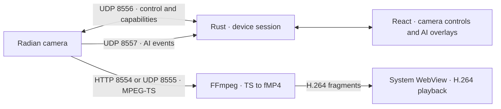

<div align="center">


# Radian Studio

**A desktop viewfinder and control station for Radian cameras.**

Connect directly over your local network, monitor an H.264 feed, adjust camera settings, and capture photos or clips alongside on-device AI results.

[](https://github.com/tianrking/radian-studio/actions/workflows/build.yml)

[Connect a camera](#connect-a-camera) · [Build from source](#build-from-source) · [Try the simulator](#try-without-a-camera) · [简体中文](README.zh-CN.md)

</div>

## What you can do

| Capability | Desktop workflow |
| --- | --- |
| **Connect** | Enter an IPv4 address or discover cameras on a local /24 subnet. Read device capabilities with `GET_CAPS` or use the confirmed v1.0 compatibility path. |
| **Frame a shot** | Preview over HTTP or UDP with automatic reconnect, zoom and pan, flips, a framing grid, a luminance histogram, and an optional horizon guide. |
| **Tune the camera** | Adjust bitrate, GOP, white balance, exposure, shutter and ISO limits, image enhancements, and scene presets. |
| **Inspect on-device AI** | Choose from installed models and show detections, keypoints, segmentation masks, and CLIP regions as supported by the camera. |
| **Search by description** | Browse the camera’s vocabulary or sync a custom English or Chinese prompt using a matching MobileCLIP text model. |
| **Capture and review** | Take single, timed, or burst JPEGs. Record clips, browse AI highlight markers, trim, and export to a local folder. |

## Connect a camera

1. Join the camera’s Wi-Fi network or use a LAN that can reach it.
2. Enter the camera’s IPv4 address in **Device address**. The SG2002 reference hotspot defaults to `192.168.88.1`.
3. Select **HTTP · 8554** and click **Connect**. HTTP is the preferred first test and can run alongside the Android client’s UDP preview.
4. To test **UDP · 8555**, disconnect the Android client’s UDP preview first. The reference firmware has one UDP video destination and one AI subscriber.

On macOS, grant local-network access when prompted. If the camera’s address is unknown, enter an address within its subnet and choose **Scan subnet**.

## Project status

| Target | Verification |
| --- | --- |
| **macOS · Apple Silicon** | Packaged app verified with the local simulator. Tested 720p30 HTTP and UDP preview, UDP recovery, photo and video capture, AI events, CLIP prompt sync, and highlight trimming. |
| **Windows · x64 / Ubuntu · x64** | Native build jobs are configured. Video playback in an installed package is pending platform verification. |
| **SG2002 reference hardware** | Client behavior follows the shared specification and was checked against the reference implementation. Direct hardware verification is pending. |

On desktops with no orientation sensor, the horizon overlay shows a level reference line. Dive telemetry reflects the camera’s report. Some v1.0 telemetry and enhancement fields are placeholders in the SG2002 firmware.

## Build from source

You need Node.js 24, the Rust toolchain pinned in this repository, the [Tauri platform prerequisites](https://v2.tauri.app/start/prerequisites/), and FFmpeg. Studio looks beside its executable, in common macOS installation directories, and on `PATH`. Set `RADIAN_FFMPEG` to an absolute path to select a specific binary.

```sh
git clone https://github.com/tianrking/radian-studio.git
cd radian-studio
npm ci
npm run tauri -- build --bundles app
```

| Platform | Bundle argument |
| --- | --- |
| macOS | `--bundles app` |
| Windows | `--bundles nsis` |
| Ubuntu | `--bundles deb` |

Run the build on the target operating system. The installed WebView must support H.264 through Media Source Extensions. For Linux, verify codec availability separately from the WebKitGTK build dependencies.

### Custom scene search

The camera’s built-in CLIP vocabulary is available when its firmware advertises a scene-search model. To encode custom prompts locally, import the matching MobileCLIP and Marian assets from an authorized checkout of the Android reference client **before building**.

```sh
node scripts/import-clip.mjs ../radian-android/app/src/main/assets/clip
```

The public source tree and CI bundles exclude these model assets. Studio sends custom embeddings only when the camera declares the matching embedding space and a dimension of 512.

## Try without a camera

Generate a 720p30 test stream using FFmpeg with libx264, then start the Rust simulator.

```sh
ffmpeg -f lavfi -i testsrc2=size=1280x720:rate=30 -t 3 -an -c:v libx264 \
  -preset ultrafast -tune zerolatency -bf 0 -g 30 -sc_threshold 0 \
  -x264-params repeat-headers=1 -mpegts_pmt_start_pid 0x1000 \
  -mpegts_start_pid 0x0100 -f mpegts sample.ts

cargo run --locked --manifest-path src-tauri/Cargo.toml --bin radian-sim -- sample.ts
```

Connect Studio to `127.0.0.1`. To check recovery, stop and restart the simulator while Studio is connected. The test pattern and AI events are synthetic.

<details>
<summary>Protocol and model regression checks</summary>

Build the frontend first. Point the tests at the official capabilities fixture and a local fragmented MP4 sample. The separate model check uses the Android tokenizer vectors and imported model assets.

```sh
npm run build
RADIAN_PROTOCOL_FIXTURE=/path/to/radian-protocol/fixtures/sg2002-caps.json \
  RADIAN_FMP4_FIXTURE=/path/to/sample.fmp4 \
  cargo test --locked --manifest-path src-tauri/Cargo.toml

node scripts/test-clip.mjs ../radian-android/app/src/test/resources/clip/tokenizer_vectors.json
```

</details>

## Architecture



The Rust session owns UDP control, stream lifecycle, reconnects, and capture storage. FFmpeg repackages the H.264 stream without re-encoding. The system WebView decodes video and the React interface renders camera controls and AI overlays. Custom scene search runs locally in an ONNX Runtime worker.

## Radian ecosystem

[Radian Protocol](https://github.com/tianrking/radian-protocol) defines the shared wire contract. [SG2002 firmware](https://github.com/tianrking/radian-fw-sg2002) and [OpenRadian for Android](https://github.com/tianrking/radian-android) are the reference implementations. Access to the reference repositories may require GitHub permissions.

This integration was checked against protocol commit `590af4a` and Android commit `a67001b`.
