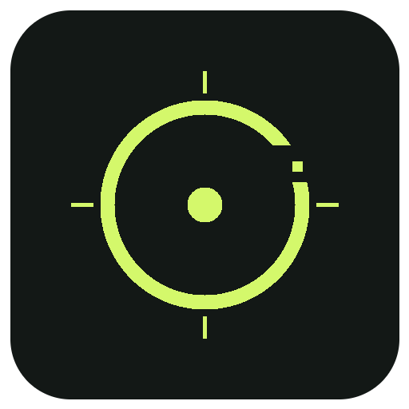
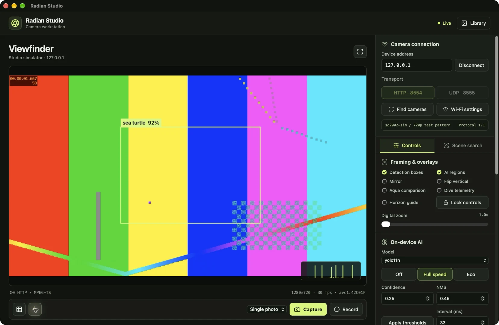

<div align="center">
  

  <h1>Radian Studio</h1>

  <p><strong>A desktop viewfinder and control station for Radian cameras.</strong></p>
  <p>Preview live video, tune the camera, and capture photos and clips over your local network.</p>

  <a href="https://github.com/tianrking/radian-studio/actions/workflows/build.yml"></a>

  <p>
    <a href="#connect-a-camera">Connect a camera</a> ·
    <a href="#build-from-source">Build from source</a> ·
    <a href="#try-without-a-camera">Try the simulator</a> ·
    <a href="README.zh-CN.md">简体中文</a>
  </p>

  
  <p><sub>Radian Studio on macOS with the built-in camera simulator.</sub></p>
</div>

## Connect a camera

1. Connect your computer to the camera over Ethernet or join the camera’s Wi-Fi network. On macOS, allow local-network access when prompted.
2. In Studio, open **Find cameras** or enter the camera’s IPv4 address in **Device address**. The SG2002 reference hotspot uses `192.168.88.1` by default.
3. Select **HTTP · 8554** for the first preview, then click **Connect**. To use **UDP · 8555**, first stop the Android client’s UDP preview. The reference firmware supports one UDP video destination and one AI event subscriber.

Studio discovers v1.2 cameras with `GET_CAPS` broadcasts on directly attached IPv4 networks, including Ethernet link-local networks. You can enter the address manually if broadcast discovery is unavailable. `GET_CAPS` also tells Studio which camera controls and AI features to expose. Earlier devices use the legacy control path.

## Features

| Feature | Desktop workflow |
| --- | --- |
| **Viewfinder** | H.264 over HTTP or UDP, automatic reconnect, digital zoom and pan, mirror and flip, grid, histogram, and horizon guide. |
| **Camera controls** | Bitrate, GOP, white balance, exposure, shutter and ISO limits, and image presets as supported by the camera. |
| **On-device AI** | Model selection and overlays for detections, keypoints, segmentation, and CLIP regions as supported by the camera. |
| **Scene search** | Browse the camera’s CLIP vocabulary or sync custom English and Chinese prompts with matching local model assets. |
| **Capture and review** | Single, timed, and burst JPEG capture, MP4 recording, AI highlight markers, clip trimming, and local export. |

## Verified compatibility

| Target | Coverage |
| --- | --- |
| **macOS · Apple Silicon** | Packaged app exercised with the simulator for 720p30 HTTP and UDP preview, UDP recovery, capture, inference events, CLIP prompt sync, and highlight trimming. |
| **KICKPI K12S-C · RV1126B** | Tested on Apple Silicon over wired Ethernet. Covers v1.2 discovery, 1440p30 HTTP and UDP preview, reconnection, advertised encoder controls, and recording. The tested firmware advertised no AI models. |
| **SG2002** | Checked against the shared specification and Android reference implementation. Direct Studio-to-SG2002 hardware verification is pending. |
| **Windows · x64 / Ubuntu · x64** | Native builds run in GitHub Actions. Playback in installed bundles is pending verification. |

## Build from source

Install Node.js 24, Rust through `rustup`, [Tauri’s platform prerequisites](https://v2.tauri.app/start/prerequisites/), and FFmpeg. The repository pins the Rust toolchain.

```sh
git clone https://github.com/tianrking/radian-studio.git
cd radian-studio
npm ci
npm run tauri -- build --bundles app
```

| Build on | Bundle argument |
| --- | --- |
| macOS | `--bundles app` |
| Windows | `--bundles nsis` |
| Ubuntu | `--bundles deb` |

Builds appear under `src-tauri/target/release/bundle/`. For local development, run `npm run tauri -- dev`. The [Desktop workflow](https://github.com/tianrking/radian-studio/actions/workflows/build.yml) publishes CI artifacts for each successful platform build.

Studio checks for FFmpeg beside its executable, in common macOS install locations, and on `PATH`. Set `RADIAN_FFMPEG` to an absolute executable path to override discovery. Playback requires H.264 support through Media Source Extensions in the system WebView. On Linux, codec availability also depends on the distribution’s media packages.

### Custom scene search

The camera’s built-in vocabulary is available when it advertises a CLIP model. To encode custom prompts locally, import the matching MobileCLIP and Marian assets from an authorized checkout of the Android reference client before building.

```sh
node scripts/import-clip.mjs ../radian-android/app/src/main/assets/clip
```

The public source tree and CI bundles exclude these model assets. Studio synchronizes custom embeddings when the camera advertises the matching embedding space and a dimension of 512.

## Try without a camera

Generate a 720p30 test stream with FFmpeg and libx264, then start the Rust simulator.

```sh
ffmpeg -f lavfi -i testsrc2=size=1280x720:rate=30 -t 3 -an -c:v libx264 \
  -preset ultrafast -tune zerolatency -bf 0 -g 30 -sc_threshold 0 \
  -x264-params repeat-headers=1 -mpegts_pmt_start_pid 0x1000 \
  -mpegts_start_pid 0x0100 -f mpegts sample.ts

cargo run --locked --manifest-path src-tauri/Cargo.toml --bin radian-sim -- sample.ts
```

Enter `127.0.0.1` in Studio and click **Connect**. Choose **On-device AI → Full speed** to see synthetic detections. Stop and restart the simulator while Studio is connected to exercise recovery.

<details>
<summary>Run regression checks</summary>

```sh
npm run build
RADIAN_PROTOCOL_FIXTURE=/path/to/radian-protocol/fixtures/sg2002-caps.json \
  RADIAN_FMP4_FIXTURE=/path/to/sample.fmp4 \
  cargo test --locked --manifest-path src-tauri/Cargo.toml
```

With the matching Android assets imported, run the tokenizer vectors separately.

```sh
node scripts/test-clip.mjs ../radian-android/app/src/test/resources/clip/tokenizer_vectors.json
```

</details>

## Architecture and protocol

Tauri hosts the React interface. Rust manages camera discovery, controls, stream sessions, and capture storage. FFmpeg remuxes MPEG-TS to fragmented MP4 without re-encoding H.264. The system WebView decodes preview video, and an ONNX Runtime worker can encode custom scene prompts locally.

| Channel | Transport |
| --- | --- |
| Discovery, controls, and capabilities | UDP to camera port `8556` |
| Live preview | MPEG-TS at `http://<camera-ip>:8554/live.ts` or over UDP to desktop port `8555` |
| Inference events | UDP JSON to desktop port `8557` |

The desktop client follows the shared [Radian Device Protocol](https://github.com/tianrking/radian-protocol). The v1.2 integration was checked against protocol revision [`27e26f3`](https://github.com/tianrking/radian-protocol/tree/27e26f392ffd26627ac672d377aae107c27d487f). The reference implementations are [Radian SG2002 firmware](https://github.com/tianrking/radian-fw-sg2002) and [OpenRadian for Android](https://github.com/tianrking/radian-android).
