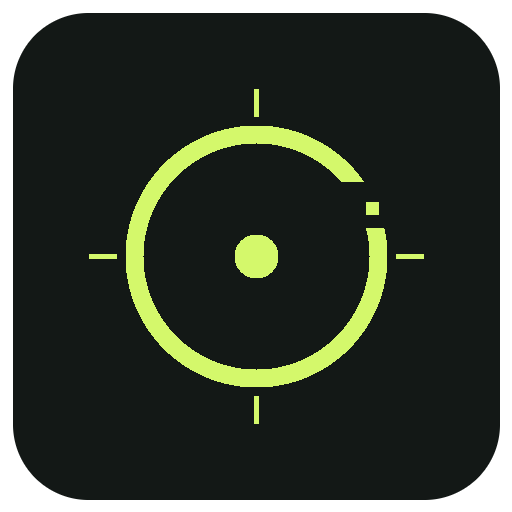

<div align="center">



# Radian Studio

**Radian 相机的桌面取景和控制工作台**

在局域网内直连相机，观看实时画面、调整设备参数、叠加相机端 AI 结果，并拍摄照片和视频。

[English](README.md) · [连接相机](#连接相机) · [构建与试用](#构建与试用)

</div>

## 功能

| 功能 | 桌面端实现 |
| --- | --- |
| 连接与取景 | 手动填写 IPv4、扫描局域网、读取 `GET_CAPS`、HTTP 与 UDP 预览、自动重连、网格、直方图和数字变焦 |
| 相机控制 | 码率、GOP、白平衡、曝光、快门和 ISO 上限、场景预设和图像增强 |
| AI 与场景搜索 | 按设备能力选择模型，叠加检测框、关键点、分割和 CLIP 区域。导入匹配模型后可运行中英文自定义搜索。 |
| 拍摄与图库 | 单张、定时、连拍、录像、AI 高光标记、片段裁剪和文件导出 |

## 连接相机

1. 让电脑加入相机热点，或连接能访问相机的局域网。
2. 在 **Device address** 填写相机 IP。SG2002 参考固件的热点默认地址是 `192.168.88.1`。
3. 先选 **HTTP · 8554**，点击 **Connect**。它可以与 Android 的 UDP 预览同时使用。
4. 若要测试 **UDP · 8555**，先断开 Android 的 UDP 预览。参考固件只保留一个 UDP 视频目的端和一个 AI 订阅端。

macOS 弹出局域网权限提示时，请允许应用访问。地址未知时可点 **Find cameras**，Studio 按活动 IPv4 接口的掩码发送定向广播。广播未发现相机时，Studio 会对已填写地址所在的 `/24` 进行单播补查。v1.2 设备的控制按钮由 `GET_CAPS` 声明的能力决定。

## 构建与试用

安装 Node.js 24、仓库固定的 Rust 工具链、FFmpeg 和 [Tauri 平台依赖](https://v2.tauri.app/start/prerequisites/)，再执行以下命令。

```sh
git clone https://github.com/tianrking/radian-studio.git
cd radian-studio
npm ci
npm run tauri -- build --bundles app
```

在对应平台上构建，Windows 使用 `--bundles nsis`，Ubuntu 使用 `--bundles deb`。无真机时可用 [Rust 模拟设备](README.md#try-without-a-camera)，并在 Studio 里连接 `127.0.0.1`。需要中英文自定义场景搜索时，请按[模型导入说明](README.md#custom-scene-search)准备授权的 Android 模型资产。

**当前验证范围**包括 Apple Silicon 上的打包应用、本地模拟器和 RV1126B 有线真机。模拟器覆盖 720p30 预览、UDP 掉线恢复、AI 事件、CLIP 词同步和高光裁剪。RV1126B 覆盖 v1.2 广播发现、1440p HTTP/UDP 预览、重连、已声明的设备控制及无 AI 时的录像。SG2002 真机及 Windows、Linux 安装后的实际播放待验收。

桌面端沿用 [统一 Radian 协议](https://github.com/tianrking/radian-protocol)。[SG2002 固件](https://github.com/tianrking/radian-fw-sg2002)和 [Android 客户端](https://github.com/tianrking/radian-android)用于参考，访问这些仓库可能需要 GitHub 权限。
